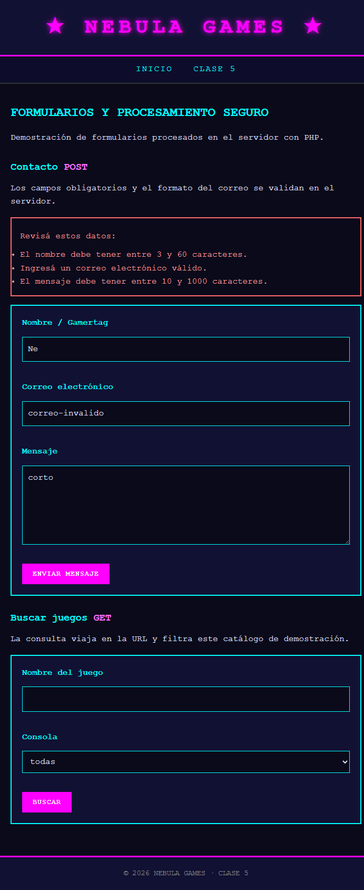
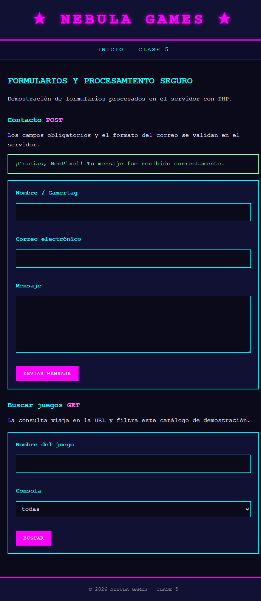
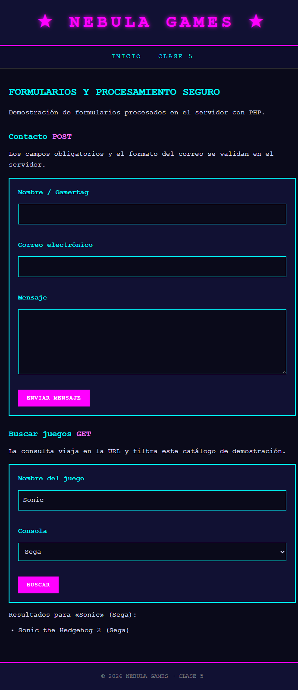

# Nebula Games

Sitio web de videojuegos retro. El sitio conserva sus páginas actuales; el
procesamiento de formularios de la **Clase 5** está en [`clase5/`](./clase5/)
y la administración del catálogo se integra desde la sección existente **Jugar**.

## Clase 5: formularios y procesamiento seguro

La página [`clase5/index.php`](./clase5/index.php) incluye dos formularios:

- **Contacto (POST):** recibe nombre, correo electrónico y mensaje. El servidor
  comprueba campos obligatorios, longitud y formato del correo. Si hay errores,
  muestra mensajes y conserva los valores ingresados; si la validación es
  correcta, informa que el mensaje fue recibido.
- **Búsqueda (GET):** filtra un catálogo de demostración por nombre del juego y
  consola (Nintendo, Sega o Atari). Los criterios se reflejan en la URL y se
  muestran los resultados correspondientes.

Los valores recibidos se recortan y validan en el servidor, y todo dato dinámico
se escapa al imprimirlo en HTML con `htmlspecialchars()`. La búsqueda limita la
longitud del texto y restringe las consolas a una lista permitida.

### Ejecutar localmente

Se necesita PHP. Para la **Clase 5**, desde la raíz del repositorio, iniciar el
servidor integrado:

```bash
php -S 127.0.0.1:8000
```

Abrir <http://127.0.0.1:8000/clase5/index.php>.

Para administrar el catálogo desde la sección existente **Jugar**, iniciá
MySQL en XAMPP y abrí <http://127.0.0.1:8000/admin/>. El módulo usa la base
`nebula_games` y las tablas `juegos`, `generos`, `consolas` y `juego_consola`
definidas en el esquema de Clase 6 [`schema.sql`](./schema.sql). Si ya creaste
esa base para la Clase 6, no necesitás importarla de nuevo. Si la base todavía
no existe, importá `schema.sql` en phpMyAdmin y cargá los datos de géneros,
fabricantes, consolas y juegos que ya forman parte de tu modelo.

La conexión PDO está en [`config/conexion.php`](./config/conexion.php). El CRUD
lista y filtra juegos, permite altas, ediciones y bajas; usa consultas
preparadas, validación de servidor, escape HTML y token CSRF.

### Capturas de funcionamiento

Las imágenes muestran la validación del formulario POST con los campos
conservados, el mensaje de éxito y una búsqueda GET filtrada:






