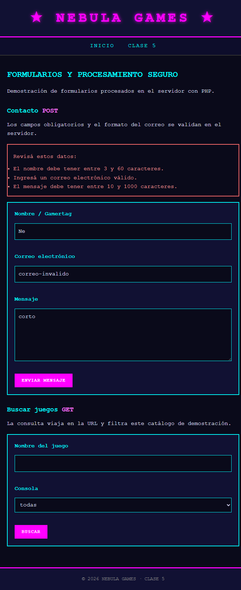
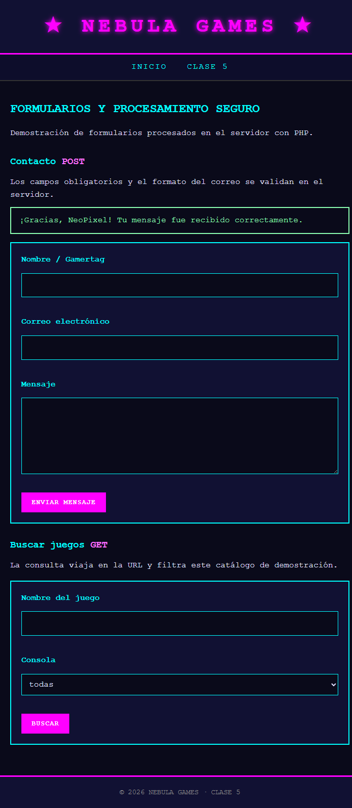
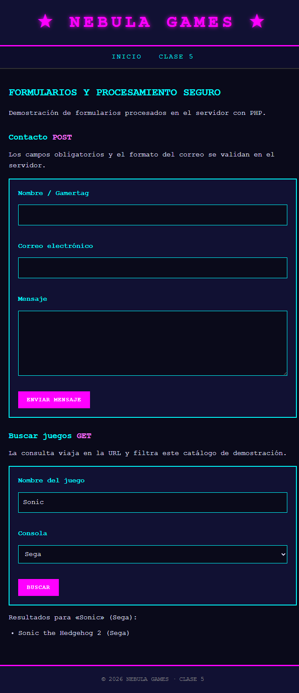

# Nebula Games

Sitio web en español dedicado a videojuegos y consolas retro. El proyecto reúne un catálogo de juegos por plataforma y género, páginas informativas, una sala arcade, registro e inicio de sesión, perfiles y administración del catálogo.

## Proyecto y refactorización

La maqueta se evolucionó a PHP para ejecutarse en un servidor local. Las vistas reutilizan plantillas SSI (`includes/header.php`, `includes/nav.php` e `includes/footer.php`), generan títulos y navegación desde el servidor (SSR) y obtienen sus parámetros globales de `.env` o de la configuración local de PHP.

## Prototipo de Figma

**Enlace de lectura:** pendiente de agregar el enlace público al prototipo original de Nebula Games.

## Tecnologías

- HTML5 y CSS3 (hoja de estilos propia y diseño adaptable).
- JavaScript.
- PHP 8.x, con PDO para el acceso a MySQL.
- MySQL/MariaDB.
- Apache mediante XAMPP o Laragon.

> Bootstrap no está incluido actualmente; la interfaz utiliza CSS propio.

## Requisitos

- XAMPP o Laragon con Apache y MySQL/MariaDB.
- PHP 8.0 o superior con las extensiones PDO MySQL, Fileinfo y Mbstring.
- Git, si vas a clonar el repositorio.

## Instalación y ejecución local

1. Cloná el repositorio en la carpeta pública de Apache. Por ejemplo, con XAMPP:

   ```bash
   cd C:\xampp\htdocs
   git clone <URL_DEL_REPOSITORIO> Nebula
   ```

   En Laragon, usá su carpeta `www`.

2. Copiá `.env.example` como `.env` en la raíz y revisá los valores de la aplicación y la conexión. El archivo `.env` es local y está excluido de Git.
3. Iniciá Apache y MySQL desde el panel de XAMPP/Laragon.
4. Abrí phpMyAdmin y ejecutá `schema.sql` para crear la base de datos `nebula_games`.
5. Opcionalmente, ejecutá `catalogo_juegos.sql` para cargar el catálogo de ejemplo. `consultas.sql` sirve para validar operaciones CRUD y termina eliminando su registro temporal de prueba.
6. Abrí `http://localhost/Nebula/`.

Para instalaciones anteriores que tengan `usuarios_app`, **no vuelvas a importar `schema.sql` sobre la base existente**. Exportá una copia de seguridad y ejecutá una sola vez `migrar_usuarios.sql` desde phpMyAdmin.

## SSI, SSR y configuración

- `includes/header.php` genera el documento HTML, los metadatos, la hoja de estilos común y el título dinámico definido mediante `$titulo_pagina` antes de incluir la plantilla.
- `includes/nav.php` renderiza la navegación y marca la sección actual con la clase `active` y `aria-current="page"`.
- `includes/footer.php` centraliza el pie de página y carga `script.js`.
- [`config/env.php`](./config/env.php) contiene la carga de configuración compartida y valores predeterminados seguros para desarrollo.
- [`.env.example`](./.env.example) documenta las variables esperadas. No guardes contraseñas reales en ese archivo ni publiques `.env`.
- `.gitignore` excluye `.env` para evitar subir configuraciones locales.

## Base de datos (TP6)

- [`normalizacion.md`](./normalizacion.md): ejemplo sin normalizar y desarrollo de 1FN, 2FN y 3FN.
- [`schema.sql`](./schema.sql): esquema MySQL con tablas, PK, FK, auditoría e índices.
- [`consultas.sql`](./consultas.sql): datos y consultas CRUD de demostración.
- [`migrar_usuarios.sql`](./migrar_usuarios.sql): migración para la tabla de usuarios antigua.
- [`catalogo_juegos.sql`](./catalogo_juegos.sql): carga opcional del catálogo retro.

Las cuentas nuevas se almacenan en `usuarios`, relacionadas con `roles`; las contraseñas se guardan con `password_hash()`. Para habilitar una cuenta administradora después de registrarla, ejecutá en phpMyAdmin (reemplazando el correo):

```sql
USE nebula_games;

UPDATE usuarios
SET id_rol = (SELECT id_rol FROM roles WHERE nombre = 'admin')
WHERE email = 'admin@example.com';
```

## TP8: sesiones, autenticación y roles

El módulo está integrado en la aplicación principal y usa PDO/MySQL:

- **Base de datos:** [`schema.sql`](./schema.sql) define `usuarios` con `id_usuario` autoincremental, nombre, email único, `password_hash` de 255 caracteres, marcas de tiempo y una FK a `roles`. El rol se normaliza en una tabla maestra en vez de repetirse como texto en cada usuario.
- **Registro e inicio de sesión:** [`auth/login.php`](./auth/login.php) contiene ambos formularios. El registro valida nombre, email y contraseña, verifica que el email no exista y guarda el hash generado con `password_hash(..., PASSWORD_BCRYPT)` mediante consulta preparada. El login recupera el hash con PDO, lo comprueba usando `password_verify()`, regenera el ID de sesión y guarda `usuario_id`, `usuario_nombre` y `rol` en `$_SESSION`.
- **Cookies de sesión:** [`includes/session_bootstrap.php`](./includes/session_bootstrap.php) inicia la sesión con cookies `HttpOnly`, `SameSite=Lax` y `Secure` cuando la conexión usa HTTPS.
- **Control de acceso:** [`includes/auth_guard.php`](./includes/auth_guard.php) redirige a la pantalla de login si no hay sesión y restringe por rol cuando corresponde. Protege, entre otras, [`panel.php`](./panel.php) (usuario autenticado) y [`admin_panel.php`](./admin_panel.php) / [`admin/index.php`](./admin/index.php) (solo `admin`).
- **Cierre de sesión:** [`auth/logout.php`](./auth/logout.php) vacía `$_SESSION`, expira la cookie y destruye la sesión antes de redirigir al inicio del proyecto.

Para probarlo localmente, creá una cuenta desde `http://localhost/Nebula/auth/login.php#registro`, iniciá sesión y abrí **Mi panel** desde el botón **Cuenta**. El acceso de administrador se habilita cambiando el rol de esa cuenta con el SQL de la sección Administración. Al cerrar sesión, las rutas protegidas deben volver a solicitar autenticación.

## Evidencia para la entrega

Guardá capturas propias en `docs/capturas/` y actualizá los enlaces siguientes antes de entregar:

- [ ] Sitio ejecutándose en `http://localhost/Nebula/`.
- [ ] Código de `includes/header.php`, `includes/nav.php` e `includes/footer.php`.
- [ ] Títulos distintos y enlace activo al navegar entre secciones.
- [ ] `.env.example` presente en el repositorio (sin publicar `.env`).
- [x] TP8: registro, login, sesiones seguras, rutas protegidas por autenticación y rol, y logout.

## Git y entrega

El flujo solicitado para la entrega es trabajar en una rama como `feature/migracion-php-ssi`, integrar los cambios mediante Pull Request a `main` y entregar el enlace público del repositorio. Usá commits pequeños y descriptivos, por ejemplo `feat: modulariza las vistas con SSI y títulos dinámicos`.


## Clase 5: Seguridad web, formularios POST y GET

El procesamiento de formularios de esta entrega está en [`clase5/`](./clase5/).

La página [`clase5/index.php`](./clase5/index.php) incluye dos formularios:

- **Contacto (POST):** recibe nombre, correo electrónico y mensaje. El servidor
  comprueba campos obligatorios, longitud y formato del correo. Si hay errores,
  muestra mensajes y conserva los valores ingresados; si la validación es
  correcta, informa que el mensaje fue recibido.
- **Búsqueda (GET):** filtra un catálogo de demostración por nombre del juego y
  consola (Nintendo, Sega o Atari). Los criterios se reflejan en la URL y se
  muestran los resultados correspondientes.

Los valores recibidos se recortan y validan en el servidor, y todo dato dinámico
se escapa al imprimirlo en HTML con `htmlspecialchars()`. La búsqueda limita la
longitud del texto y restringe las consolas a una lista permitida.

### Ejecutar localmente

Se necesita PHP. Para la **Clase 5**, desde la raíz del repositorio, iniciar el
servidor integrado:

```bash
php -S 127.0.0.1:8000
```

Abrir <http://127.0.0.1:8000/clase5/index.php>.

Para administrar el catálogo desde la sección existente **Jugar**, iniciá
MySQL en XAMPP y abrí <http://127.0.0.1:8000/admin/>. El módulo usa la base
`nebula_games` y las tablas `juegos`, `generos`, `consolas` y `juego_consola`
definidas en el esquema de Clase 6 [`schema.sql`](./schema.sql). Si ya creaste
esa base para la Clase 6, no necesitás importarla de nuevo. Si la base todavía
no existe, importá `schema.sql` en phpMyAdmin y cargá los datos de géneros,
fabricantes, consolas y juegos que ya forman parte de tu modelo.

La conexión PDO está en [`config/conexion.php`](./config/conexion.php). El CRUD
lista y filtra juegos, permite altas, ediciones y bajas; usa consultas
preparadas, validación de servidor, escape HTML y token CSRF.

### Capturas de funcionamiento

Las imágenes muestran la validación del formulario POST con los campos
conservados, el mensaje de éxito y una búsqueda GET filtrada:







## Migración a PHP, Modularización (SSI) y Renderizado Server-Side (SSR)

Objetivo: convertir la maqueta estática del Hito 1 en un sitio PHP con plantillas comunes, título dinámico y configuración por entorno.

- **Plantillas SSI:** `includes/header.php`, `includes/nav.php` y `includes/footer.php`, incluidas con `require_once` desde las vistas.
- **Título dinámico:** cada vista define `$titulo_pagina` antes de incluir `header.php`.
- **Navegación activa:** `nav.php` marca el enlace de la sección actual con `active` y `aria-current="page"`.
- **Configuración (.env):** variables globales de nombre del sitio, correo de contacto y `APP_ENV=local`. `.env` está excluido de Git; `.env.example` sirve de plantilla.

Estado de la migración (pendiente de completar):

- [ ] Renombrar las páginas `.html` restantes a `.php` (la raíz aún contiene archivos `.html`).
- [ ] Incorporar `config/env.php` y `.env.example` al repositorio.
- [ ] Capturas de sitio ejecutándose, código de las plantillas y del `.env.example`.

## Persistencia y conexión PHP-MySQL segura (PDO y CRUD)

Objetivo: conectar PHP con MySQL mediante PDO y construir un CRUD integrado al sitio.

- **Conexión:** [`config/conexion.php`](./config/conexion.php) crea la instancia PDO con `ERRMODE_EXCEPTION` dentro de un bloque `try-catch (PDOException)`.
- **Módulo:** [`admin/`](./admin/) con `index.php` (listado), `crear.php` (alta), `editar.php` (modificación) y `eliminar.php` (baja).
- **Seguridad:** todas las consultas usan sentencias preparadas con marcadores nombrados, y las variables impresas en HTML pasan por `htmlspecialchars()`.
- **Entidad:** juegos, con las tablas definidas en [`schema.sql`](./schema.sql).

## Manejo de Estado, Sesiones y Autenticación

Objetivo: persistir el estado del usuario con `$_SESSION` y cookies seguras, y proteger rutas por rol.

- **Registro y login:** [`auth/register.php`](./auth/register.php) y [`auth/login.php`](./auth/login.php). El registro verifica que el email no exista y guarda el hash con `password_hash(..., PASSWORD_BCRYPT)`. El login compara con `password_verify()` y, ante credenciales correctas, regenera el ID de sesión y guarda `usuario_id`, `usuario_nombre` y `rol`.
- **Logout:** [`auth/logout.php`](./auth/logout.php) vacía `$_SESSION`, expira la cookie de sesión y ejecuta `session_destroy()`.
- **Control de acceso:** las vistas protegidas verifican `$_SESSION['usuario_id']` y, en el área de administración, el rol `admin`.

Estado (pendiente de completar):

- [ ] Guardián reutilizable `includes/auth_guard.php` (redirige a `login.php?error=acceso_denegado`).
- [ ] Gestor de cookies de sesión `includes/session_bootstrap.php` (`HttpOnly`, `SameSite`, `Secure`).
- [ ] Dos vistas protegidas por sesión y una restringida por rol.

## Base de datos: modelo y normalización

- [`normalizacion.md`](./normalizacion.md) (pendiente de incluir en el repositorio): desarrollo de 1FN, 2FN y 3FN.
- [`schema.sql`](./schema.sql): tablas con PK, FK, auditoría (`created_at`) e índices.
- [`consultas.sql`](./consultas.sql): datos de demostración y consultas CRUD.
